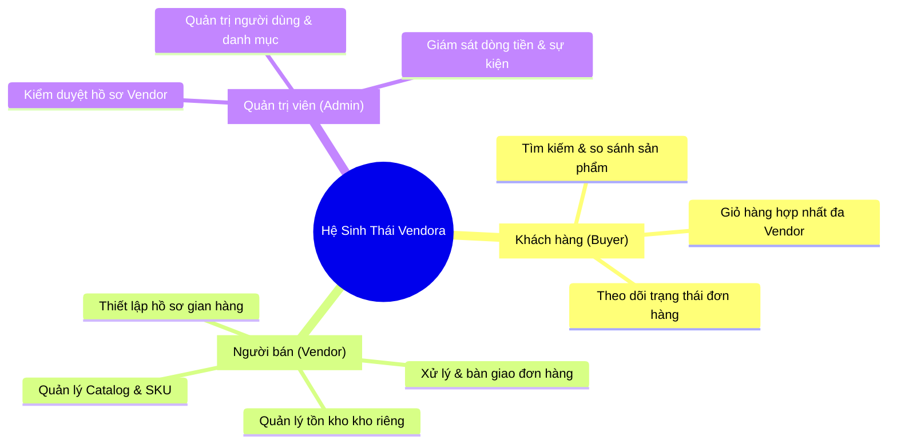
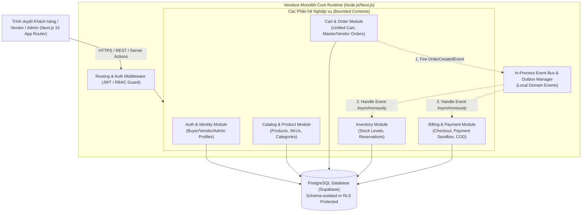
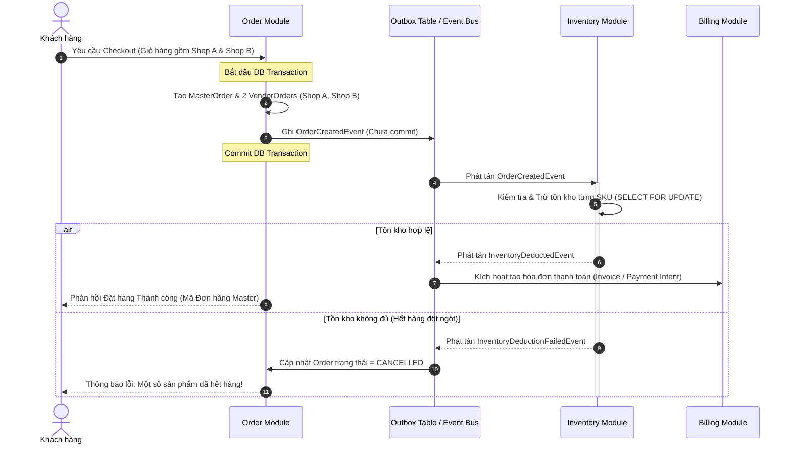
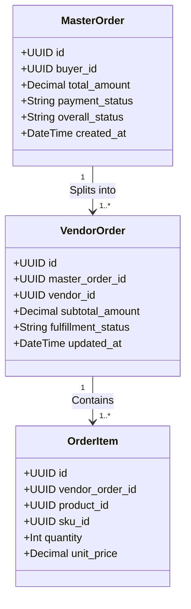
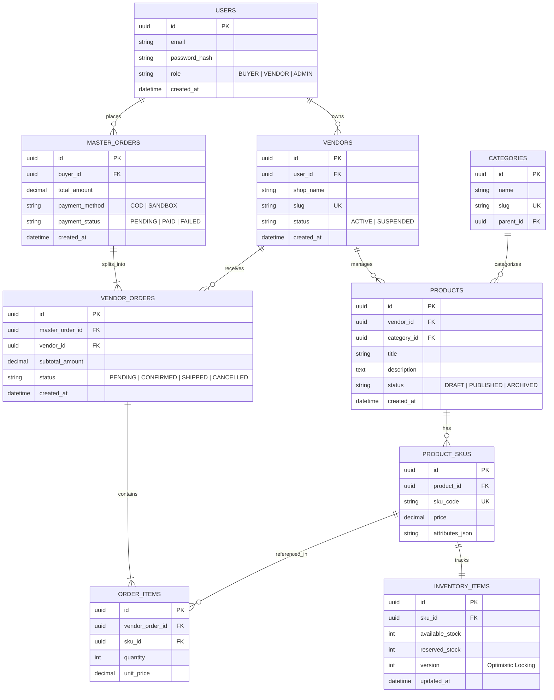

# Product Requirements Document (PRD)
## Project: Vendora – Multi-Vendor E-Commerce Modular Monolith
**Phiên bản:** 1.0 (MVP)  
**Tác giả:** Đội ngũ Kiến trúc & Kỹ thuật Hệ thống Vendora  
**Trạng thái:** Sẵn sàng Triển khai (Approved for Engineering)  
**Lưu trữ:** Monorepo `/docs/PRD.md`

---

## 1. Tuyên bố Vấn đề & Bối cảnh (Problem Statement & Context)

### 1.1. Bối cảnh Thị trường & Nỗi đau Doanh nghiệp (Pain Points)
Trong mô hình bán lẻ thương mại điện tử truyền thống (Single-Vendor), hệ thống chỉ phục vụ một đơn vị bán hàng duy nhất với một kho hàng tập trung. Tuy nhiên, khi chuyển đổi sang mô hình kinh doanh sàn thương mại điện tử đa người bán (Multi-Vendor Marketplace):
- **Khách hàng (Buyer):** Phải tạo nhiều đơn hàng rời rạc nếu mua từ nhiều người bán khác nhau, chịu trải nghiệm thanh toán phân mảnh và khó khăn trong theo dõi đơn hàng tổng thể.
- **Người bán (Vendor):** Thiếu công cụ quản trị độc lập để kiểm soát danh mục sản phẩm, biến thể (SKU), tồn kho thực tế và đơn hàng riêng biệt của gian hàng mình mà không can thiệp vào dữ liệu của người bán khác.
- **Nền tảng (Platform Operator):** Đối mặt với chi phí hạ tầng đắt đỏ và độ phức tạp vận hành cực lớn nếu vội vã triển khai kiến trúc Vi dịch vụ (Microservices) ngay từ giai đoạn khởi đầu; hoặc ngược lại, gặp bế tắc về nợ kỹ thuật (Technical Debt) và rò rỉ dữ liệu (Cross-tenant Data Leakage) nếu nhồi nhét mã nguồn vào một khối Monolith hỗn loạn không có ranh giới module rõ ràng.

### 1.2. Giải pháp: Nền tảng Vendora (Modular Monolith Architecture)
Vendora được định nghĩa là một nền tảng thương mại điện tử đa người bán được xây dựng trên mô hình **Modular Monolith**. Hệ thống đảm bảo:
1. **Trải nghiệm Mua sắm Hợp nhất (Unified Shopping Experience):** Khách hàng duyệt sản phẩm từ nhiều gian hàng, thêm vào một giỏ hàng duy nhất và tiến hành thanh toán một lần (One-stop Checkout).
2. **Quản trị Độc lập theo Gian hàng (Multi-Tenant Vendor Autonomy):** Hệ thống tự động phân tách đơn hàng tổng (Master Order) thành các đơn hàng con theo từng Vendor (Sub-Orders / Vendor Orders). Tồn kho (Inventory) được cô lập và quản lý riêng biệt cho từng gian hàng.
3. **Kiến trúc Bền vững, Chi phí Tối ưu:** Toàn bộ hệ thống chạy chung một mã nguồn triển khai (Single Deployable Artifact qua Docker/Serverless) nhưng phân chia các Module nghiệp vụ độc lập (Bounded Contexts), giao tiếp qua In-process Event Bus (Local Domain Events), sẵn sàng tách thành Microservices trong tương lai khi lưu lượng tăng trưởng mà không cần đập bỏ viết lại.

---

## 2. Mục tiêu & Chỉ số Đo lường Thành công (Goals & Metrics)

### 2.1. Mục tiêu Kinh doanh & Sản phẩm (Objectives)
- Xây dựng thành công bản phát hành MVP (Must-Have) đáp ứng đầy đủ chu trình mua bán từ Đăng ký gian hàng -> Đăng bán sản phẩm -> Giỏ hàng đa shop -> Đặt hàng & Tách đơn -> Trừ kho tự động theo sự kiện -> Xác nhận thanh toán.
- Đảm bảo tính toàn vẹn dữ liệu 100% giữa các Module (Catalog, Order, Inventory, Billing) mà không xảy ra hiện tượng bán vượt tồn kho (Overselling) hoặc đơn hàng mồ côi (Ghost Orders).

### 2.2. Chỉ số Đo lường Thành công (Key Metrics)

| Loại chỉ số | Tên chỉ số | Mục tiêu MVP (Threshold) | Phương pháp đo lường |
| :--- | :--- | :--- | :--- |
| **Leading Metric** (Dẫn dắt) | Tỷ lệ hoàn tất Checkout (Checkout Completion Rate) | $\ge 70\%$ số giỏ hàng bước vào checkout hoàn tất đặt hàng | Phân tích phễu sự kiện (Funnel Analytics: Cart -> Order Created) |
| **Leading Metric** (Dẫn dắt) | Thời gian Onboarding Vendor | $\le 5$ phút để Vendor hoàn tất tạo shop & đăng sản phẩm đầu tiên | Theo dõi timestamp từ Register -> Product Published |
| **Lagging Metric** (Độ trễ) | Tỷ lệ xung đột tồn kho (Overselling Incidents) | $0\%$ lỗi bán vượt tồn kho khi concurrency cao | Nhật ký kiểm toán Inventory Audit Logs |
| **Engineering Metric** | Thời gian phản hồi API (P95 Latency) | $\le 200\text{ ms}$ cho các thao tác đọc catalog, $\le 500\text{ ms}$ cho checkout | APM / Server Logs |
| **Engineering Metric** | Tách đơn hàng tự động (Order Splitting Success) | $100\%$ đơn hàng đa shop được chia đúng Vendor Order | Automated E2E Test Suite |

---

## 3. Chân dung Người dùng (User Personas)



### 3.1. Persona 1: Khách hàng (Buyer) - "Minh Anh" (26 tuổi, Nhân viên Văn phòng)
- **Hành vi & Mục tiêu:** Cần tìm kiếm quần áo, phụ kiện từ nhiều thương hiệu độc lập; muốn gom chung vào một giỏ hàng, thanh toán một lần và theo dõi minh bạch thời gian giao của từng shop.
- **Rào cản:** Ngại đăng ký nhiều tài khoản, ghét việc giỏ hàng bị hủy giữa chừng do hết hàng bất ngờ (out-of-stock shock).
- **Trình độ kỹ thuật:** Sử dụng thành thạo web/mobile browser tiêu chuẩn.

### 3.2. Persona 2: Người bán (Vendor) - "Hoàng Long" (32 tuổi, Chủ shop thời trang)
- **Hành vi & Mục tiêu:** Đăng ký gian hàng để tiếp cận tệp khách hàng của sàn; cần công cụ đơn giản để tạo sản phẩm, cài đặt số lượng tồn kho (stock level) và nhận thông báo khi có đơn hàng mới phát sinh cần chuẩn bị.
- **Rào cản:** Sợ sai lệch số lượng tồn giữa các kênh bán, sợ lộ thông tin doanh thu và danh sách khách hàng cho các shop đối thủ trên cùng sàn.
- **Trình độ kỹ thuật:** Trung bình; quen thuộc với các giao diện quản trị thương mại điện tử cơ bản.

### 3.3. Persona 3: Quản trị viên Sàn (Platform Admin) - "Thu Hà" (29 tuổi, Vận hành Sàn)
- **Hành vi & Mục tiêu:** Duyệt các yêu cầu mở gian hàng để đảm bảo uy tín của sàn; quản lý cây danh mục hệ thống (Categories); can thiệp xử lý khi có gian hàng vi phạm chính sách hoặc gian lận đơn hàng.
- **Rào cản:** Khó truy vết lỗi khi có khiếu nại giữa người mua và người bán nếu hệ thống thiếu nhật ký giao dịch minh bạch.

---

## 4. Kiến trúc Tổng thể & Thiết kế Modular Monolith (Architectural Design)

### 4.1. Cấu trúc Phân hệ Bounded Contexts
Hệ thống được thiết kế theo nguyên lý **Domain-Driven Design (DDD)** trong một **Modular Monolith**:
- Mỗi module sở hữu logic nghiệp vụ riêng, các domain entities riêng, và giao diện công khai (Public Interface/Facade).
- Nghiêm cấm việc Module A truy vấn trực tiếp bảng dữ liệu nội bộ (Database Table) của Module B. Mọi trao đổi đồng bộ phải qua API Public Contract; trao đổi bất đồng bộ phải thông qua **Domain Event Bus**.



### 4.2. Cơ chế Xử lý Sự kiện Nội bộ (Event-Driven Transactional Boundary)
Để giải quyết bài toán trừ tồn kho khi tạo đơn hàng mà không gây thắt cổ chai hoặc phụ thuộc chéo:
1. **Order Module** nhận yêu cầu Checkout -> Lưu thông tin `MasterOrder` và các `VendorOrder` vào Database trong một Database Transaction cục bộ.
2. Ngay trong Transaction đó, ghi một bản ghi sự kiện `OrderCreatedEvent` vào bảng `outbox_events` (mô hình **Transactional Outbox**).
3. **Event Bus** điều phối sự kiện `OrderCreatedEvent` tới **Inventory Module**:
   - Inventory Module tiến hành giữ chỗ (Stock Reservation) hoặc trừ trực tiếp số lượng khả dụng (`available_stock`).
   - Nếu tồn kho đủ: Xác nhận giữ chỗ thành công (`InventoryReservedEvent`).
   - Nếu tồn kho không đủ (Out of stock do concurrency): Bắn sự kiện `InventoryReservationFailedEvent` -> Order Module tự động cập nhật trạng thái đơn sang `FAILED_OUT_OF_STOCK` và thông báo tới người dùng.



---

## 5. Phân loại Tính năng theo Mô hình MoSCoW (Feature Prioritization)

| Phân loại | Mã Module | Tên Tính năng | Mô tả Nghiệp vụ Cốt lõi | Giá trị & Lý do chọn lọc |
| :--- | :--- | :--- | :--- | :--- |
| 🟢 **MUST HAVE**<br/>*(Giai đoạn 1 - MVP Lõi)* | **AUTH-01** | Xác thực & Phân quyền RBAC | Đăng ký, đăng nhập (Email/Password), hỗ trợ 3 Roles: `BUYER`, `VENDOR`, `ADMIN`. JWT lưu tại HttpOnly Cookie với Refresh Token Rotation. | Đảm bảo an toàn danh tính, ngăn chặn truy cập trái phép ngay từ tầng dữ liệu. |
| 🟢 **MUST HAVE** | **VEND-01** | Đăng ký & Onboarding Gian hàng | User có thể đăng ký nâng cấp tài khoản lên Vendor, cung cấp Tên Shop, Slug, Địa chỉ kho hàng. Mặc định trạng thái kích hoạt thử nghiệm. | Nền tảng cho mô hình Multi-Vendor, khởi tạo ID gian hàng. |
| 🟢 **MUST HAVE** | **CAT-01** | Quản lý Sản phẩm theo Vendor | Vendor: Thêm/Sửa/Xóa sản phẩm của chính shop mình (Tên, Mô tả, Giá, SKU, Ảnh đại diện, Danh mục). RLS ngăn Vendor A sửa đồ Vendor B. | Nghiệp vụ cốt lõi của người bán. |
| 🟢 **MUST HAVE** | **CAT-02** | Khám phá Catalog (Buyer) | Buyer: Xem danh sách sản phẩm phân trang, xem chi tiết sản phẩm kèm thông tin gian hàng bán (Shop info). | Trải nghiệm mua sắm cơ bản của khách hàng. |
| 🟢 **MUST HAVE** | **CART-01** | Giỏ hàng Hợp nhất (Unified Cart) | Khách hàng thêm sản phẩm từ nhiều Vendor khác nhau vào một giỏ hàng chung. Tính toán tạm tính theo từng shop. | Trải nghiệm người dùng đồng nhất, không bắt buyer chia giỏ hàng thủ công. |
| 🟢 **MUST HAVE** | **ORD-01** | Checkout & Tách Đơn (Order Splitting) | Khi khách bấm đặt hàng, hệ thống tạo 1 `MasterOrder` và tự động phân tách thành các `VendorOrder` độc lập tương ứng với từng shop. | **Cốt lõi Multi-Vendor:** Cho phép từng shop quản lý và xử lý đơn độc lập. |
| 🟢 **MUST HAVE** | **INV-01** | Tồn kho Hướng Sự kiện (Event-Driven Stock) | Mỗi SKU gắn với số lượng tồn kho của Vendor. Khi có `OrderCreatedEvent`, hệ thống kiểm tra và trừ tồn kho (sử dụng Transaction Lock chống Overselling). | Thể hiện chuẩn mực kiến trúc Distributed Monolith, đảm bảo toàn vẹn dữ liệu. |
| 🟢 **MUST HAVE** | **BILL-01** | Thanh toán Cơ bản & Giả lập Sandbox | Hỗ trợ 2 phương thức: COD (Cash on Delivery) và Thanh toán Giả lập (Mock Payment Gateway: Success/Fail toggle). Tính toán tổng tiền chính xác. | Hoàn thiện chu trình chuyển đổi mà không vướng thủ tục pháp lý cổng thanh toán thật trong MVP. |
| 🟡 **SHOULD HAVE**<br/>*(Giai đoạn 2 - Hoàn thiện)* | **SHIP-01** | Quản lý Vận chuyển theo Đơn hàng con | Từng Vendor cập nhật trạng thái đơn của mình: `PENDING` -> `PROCESSING` -> `SHIPPED` -> `DELIVERED`. | Hoàn thiện chuỗi cung ứng thực tế. |
| 🟡 **SHOULD HAVE** | **DASH-01** | Vendor & Admin Dashboard | Vendor xem thống kê doanh thu, đơn cần chuẩn bị, cảnh báo sắp hết hàng. Admin xem tổng quan GMV toàn sàn. | Cung cấp công cụ đo lường và quản trị. |
| 🟡 **SHOULD HAVE** | **CAT-03** | Tìm kiếm & Bộ lọc Nâng cao | Tìm kiếm theo từ khóa (Fuzzy search), lọc theo khoảng giá, phân loại theo danh mục cha/con. | Cải thiện khả năng khám phá sản phẩm khi catalog phình to. |
| 🟡 **SHOULD HAVE** | **REV-01** | Đánh giá & Chấm điểm (Review & Rating) | Khách hàng đã mua hàng thành công có quyền để lại đánh giá 1-5 sao và bình luận cho sản phẩm. | Tạo niềm tin xã hội (Social Proof) cho sàn. |
| 🟡 **SHOULD HAVE** | **BILL-02** | Cổng Thanh toán Thật (VNPay / Stripe) | Tích hợp Webhook và Redirect URL thanh toán ngân hàng/thẻ quốc tế thực tế. | Đưa hệ thống vào thương mại hóa thực chiến. |
| 🔵 **COULD HAVE**<br/>*(Giai đoạn 3 - Nâng cao)* | **MKT-01** | Hệ thống Mã Giảm giá (Voucher Engine) | Mã giảm giá toàn sàn (Platform Voucher) và mã giảm giá riêng của từng shop (Shop Voucher). | Chiến lược thu hút và giữ chân người dùng. |
| 🔵 **COULD HAVE** | **BILL-03** | Phân chia Dòng tiền Tự động (Split Payment) | Tự động giữ lại % hoa hồng sàn (Commission) và kết chuyển số dư khả dụng về ví Vendor sau khi đơn hoàn tất. | Nghiệp vụ tài chính nâng cao. |
| 🔵 **COULD HAVE** | **CHAT-01** | Trò chuyện Trực tiếp (Real-Time Chat) | Nhắn tin thời gian thực giữa Khách hàng và Người bán qua WebSockets / Supabase Realtime. | Hỗ trợ tư vấn mua hàng trực tiếp. |
| 🔵 **COULD HAVE** | **SRCH-01** | Tối ưu Bộ đệm & Tìm kiếm (Redis / Meilisearch) | Cache catalog trên Redis, full-text search với độ trễ < 50ms. | Tối ưu hóa hiệu năng khi quy mô mở rộng. |
| 🔴 **WON'T HAVE**<br/>*(Loại bỏ khỏi phạm vi)* | **NON-01** | Kiến trúc Vi dịch vụ Độc lập (Microservices) | Không tách nhiều repo hay deploy cụm Kubernetes; giữ vững Modular Monolith để deploy tối giản qua Docker. | Ngăn chặn bẫy Over-Engineering gây cạn kiệt tài nguyên. |
| 🔴 **WON'T HAVE** | **NON-02** | Livestream Bán hàng & Video ngắn | Không phát triển luồng truyền phát video trực tiếp. | Tránh quá tải băng thông và làm loãng mục tiêu kiến trúc cốt lõi. |
| 🔴 **WON'T HAVE** | **NON-03** | Ví điện tử nội bộ phức tạp | Không làm tính năng Nạp tiền/Rút tiền ví nội bộ P2P (tránh rủi ro pháp lý tài chính). | Giảm thiểu độ phức tạp kiểm toán và tuân thủ ngân hàng. |

---

## 6. Đặc tả Chi tiết Yêu cầu Chức năng (Functional Specs & BDD User Stories)

### 6.1. Module Xác thực & Phân quyền (Auth & Identity)

#### User Story US-AUTH-01: Đăng nhập Khách hàng & Điều hướng Phân quyền
> **Là một** Người dùng (Buyer/Vendor),  
> **Tôi muốn** đăng nhập bằng Email và Mật khẩu,  
> **Để** truy cập vào không gian làm việc hoặc tiến hành mua hàng an toàn.

- **Tiêu chí Chấp nhận (Acceptance Criteria - BDD):**
  - **Scenario 1: Đăng nhập thành công với thông tin hợp lệ**
    - **Given:** Người dùng đã có tài khoản kích hoạt trong hệ thống với email `buyer@vendora.vn`.
    - **When:** Người dùng nhập đúng email và mật khẩu tại trang `/login` và bấm nút "Đăng nhập".
    - **Then:** Hệ thống tạo một phiên làm việc hợp lệ, cấp phát Access Token (JWT thời hạn 15 phút) và Refresh Token (7 ngày) lưu trong HttpOnly Cookie; chuyển hướng người dùng về trang chủ (hoặc trang quản trị nếu là `VENDOR`/`ADMIN`).
  - **Scenario 2: Đăng nhập thất bại do sai mật khẩu**
    - **Given:** Người dùng nhập email tồn tại nhưng mật khẩu không chính xác.
    - **When:** Bấm nút "Đăng nhập".
    - **Then:** Hệ thống từ chối xác thực, trả về mã lỗi HTTP 401 Unauthorized, hiển thị thông báo "Email hoặc mật khẩu không chính xác" và không tiết lộ cụ thể trường nào sai.
  - **Scenario 3: Ngăn chặn truy cập trái quyền (RBAC Protection)**
    - **Given:** Người dùng đăng nhập với vai trò `BUYER`.
    - **When:** Cố tình truy cập đường dẫn quản trị Vendor `/vendor/products/new`.
    - **Then:** Hệ thống chặn yêu cầu tại Middleware, trả về lỗi 403 Forbidden và chuyển hướng về trang thông báo từ chối truy cập.

---

### 6.2. Module Danh mục & Sản phẩm (Catalog & Product)

#### User Story US-CAT-01: Vendor tạo Mới Sản phẩm
> **Là một** Người bán (Vendor),  
> **Tôi muốn** đăng bán một sản phẩm mới kèm các thuộc tính giá, SKU và số lượng tồn ban đầu,  
> **Để** người mua trên sàn có thể nhìn thấy và đặt mua sản phẩm của tôi.

- **Tiêu chí Chấp nhận (Acceptance Criteria - BDD):**
  - **Scenario 1: Tạo sản phẩm hợp lệ**
    - **Given:** Vendor đã đăng nhập và sở hữu một gian hàng có trạng thái `ACTIVE`.
    - **When:** Vendor điền đầy đủ form gồm: Tên sản phẩm, Danh mục hợp lệ, Giá bán $> 0$, SKU duy nhất trong shop, Tồn kho ban đầu $\ge 0$, và ít nhất 1 hình ảnh hợp lệ; sau đó bấm "Đăng bán".
    - **Then:** Hệ thống lưu sản phẩm vào bảng `products` với `vendor_id` gắn chặt với shop của Vendor đó; đồng thời tự động kích hoạt tạo bản ghi tồn kho ban đầu trong `inventory_items` với trạng thái khả dụng.
  - **Scenario 2: Cách ly dữ liệu giữa các Vendor (Isolation Verification)**
    - **Given:** Vendor A đăng nhập vào hệ thống.
    - **When:** Vendor A cố tình gửi request API `PUT /api/vendor/products/{product_id_of_vendor_b}` để sửa sản phẩm của Vendor B.
    - **Then:** Tầng truy vấn (Drizzle ORM / RLS) phát hiện `vendor_id` không khớp, từ chối cập nhật và trả về HTTP 404 Not Found hoặc 403 Forbidden.

#### User Story US-CAT-02: Khách hàng Xem Danh mục Sản phẩm
> **Là một** Khách hàng (Buyer),  
> **Tôi muốn** xem danh sách sản phẩm hiển thị trên sàn cùng thông tin rõ ràng về tên shop bán,  
> **Để** tôi có thể lựa chọn sản phẩm phù hợp với nhu cầu.

- **Tiêu chí Chấp nhận (Acceptance Criteria - BDD):**
  - **Scenario 1: Hiển thị sản phẩm đang bán**
    - **Given:** Có 20 sản phẩm thuộc các shop khác nhau đang ở trạng thái `PUBLISHED`.
    - **When:** Khách hàng truy cập trang danh mục `/products`.
    - **Then:** Hệ thống tải dữ liệu phân trang (12 sản phẩm/trang), hiển thị thẻ sản phẩm gồm: Hình ảnh, Tên sản phẩm, Giá bán niêm yết, và Huy hiệu định danh Tên Gian hàng (Vendor Badge).

---

### 6.3. Module Giỏ hàng & Đơn hàng (Cart & Order Module)

#### User Story US-ORD-01: Khách hàng Đặt hàng và Tự động Phân tách Đơn theo Shop
> **Là một** Khách hàng (Buyer),  
> **Tôi muốn** thực hiện thanh toán một lần cho giỏ hàng chứa sản phẩm từ nhiều shop khác nhau,  
> **Để** hoàn tất mua sắm mà không phải thực hiện nhiều lần đặt hàng rườm rà.

- **Tiêu chí Chấp nhận (Acceptance Criteria - BDD):**
  - **Scenario 1: Tách đơn hàng thành công (Order Splitting)**
    - **Given:** Khách hàng có 3 món trong giỏ: Món 1 (Shop A, 100k), Món 2 (Shop A, 150k), Món 3 (Shop B, 200k). Tổng giỏ hàng là 450k.
    - **When:** Khách hàng điền địa chỉ giao hàng, chọn phương thức `COD` và bấm nút "Xác nhận Đặt hàng".
    - **Then:** Hệ thống khởi tạo trong một Transaction:
      1. Tạo một `MasterOrder` với `total_amount = 450,000` và `buyer_id`.
      2. Tạo `VendorOrder 1` (Shop A) trị giá 250k với 2 items.
      3. Tạo `VendorOrder 2` (Shop B) trị giá 200k với 1 item.
      4. Xóa các món tương ứng trong giỏ hàng.
      5. Ghi nhận sự kiện `OrderCreatedEvent` vào Outbox.



---

### 6.4. Module Tồn kho Hướng Sự kiện (Inventory Module)

#### User Story US-INV-01: Tự động Giữ chỗ và Trừ Tồn kho khi có Đơn hàng
> **Là một** Hệ thống Quản trị Tồn kho,  
> **Tôi muốn** tự động khóa và trừ số lượng sản phẩm khả dụng ngay khi nhận được sự kiện `OrderCreatedEvent`,  
> **Để** đảm bảo hàng hóa không bị bán trùng lặp cho khách hàng khác.

- **Tiêu chí Chấp nhận (Acceptance Criteria - BDD):**
  - **Scenario 1: Trừ tồn kho thành công khi số lượng đáp ứng**
    - **Given:** Sản phẩm X (Shop A) có số lượng khả dụng `available_stock = 5`.
    - **When:** Sự kiện `OrderCreatedEvent` bắn ra yêu cầu mua số lượng là 2.
    - **Then:** Inventory Module sử dụng cơ chế Row-level Locking (`SELECT FOR UPDATE` trên bảng tồn kho), trừ `available_stock` từ 5 xuống 3, tăng `reserved_stock` lên 2, và xuất bản sự kiện `InventoryReservedEvent`.
  - **Scenario 2: Xử lý tranh chấp khi tồn kho không đủ (Concurrency Out-of-Stock)**
    - **Given:** Sản phẩm Y còn tồn kho `available_stock = 1`. Hai khách hàng cùng bấm thanh toán đồng thời.
    - **When:** Giao dịch đầu tiên chiếm khóa thành công và trừ tồn kho về 0. Giao dịch thứ hai nhận được số lượng khả dụng bằng 0.
    - **Then:** Giao dịch thứ hai ngay lập tức ném ngoại lệ `InsufficientStockException`, xuất bản sự kiện `InventoryReservationFailedEvent`, và kích hoạt chuỗi bù trừ để hủy đơn hàng con tương ứng, bảo toàn tính toàn vẹn hệ thống.

---

### 6.5. Module Thanh toán (Billing & Payment)

#### User Story US-BILL-01: Xử lý Thanh toán COD & Giả lập Sandbox
> **Là một** Khách hàng (Buyer),  
> **Tôi muốn** chọn hình thức Thanh toán khi nhận hàng (COD) hoặc Thanh toán Sandbox để thử nghiệm,  
> **Để** xác nhận hoàn tất giao dịch tài chính cho đơn hàng của mình.

- **Tiêu chí Chấp nhận (Acceptance Criteria - BDD):**
  - **Scenario 1: Thanh toán COD**
    - **Given:** Khách hàng chọn phương thức thanh toán là `COD`.
    - **When:** Đơn hàng tạo thành công.
    - **Then:** Trạng thái thanh toán của `MasterOrder` được gán là `PAYMENT_PENDING`, phương thức là `COD`, và cho phép đơn hàng tiến vào quy trình chuẩn bị đóng gói.
  - **Scenario 2: Thử nghiệm Sandbox Success**
    - **Given:** Khách hàng chọn phương thức thanh toán `SANDBOX_MOCK`.
    - **When:** Khách hàng click "Giả lập Thanh toán Thành công".
    - **Then:** Hệ thống cập nhật trạng thái `MasterOrder` thành `PAID`, đồng thời đồng bộ trạng thái `PAID` xuống toàn bộ các `VendorOrder` liên đới.

---

## 7. Thiết kế Kiến trúc Dữ liệu & Lược đồ Cơ sở Dữ liệu (Database Schema)

Hệ thống sử dụng **PostgreSQL** kết hợp cùng **Drizzle ORM**. Nhằm đảm bảo ranh giới Modular Monolith, các bảng được phân nhóm theo tiền tố logic đại diện cho Bounded Context.



### 7.1. Bảng Dữ liệu Outbox cho In-Process Event Bus
Để hiện thực hóa tính toàn vẹn sự kiện nội bộ theo Transactional Outbox Pattern:
```sql
CREATE TABLE outbox_events (
    id UUID PRIMARY KEY DEFAULT gen_random_uuid(),
    event_type VARCHAR(100) NOT NULL,
    aggregate_type VARCHAR(50) NOT NULL,
    aggregate_id UUID NOT NULL,
    payload JSONB NOT NULL,
    status VARCHAR(20) DEFAULT 'PENDING' CHECK (status IN ('PENDING', 'PROCESSED', 'FAILED')),
    retry_count INT DEFAULT 0,
    created_at TIMESTAMP WITH TIME ZONE DEFAULT NOW(),
    processed_at TIMESTAMP WITH TIME ZONE
);

CREATE INDEX idx_outbox_status_created ON outbox_events(status, created_at);
```

---

## 8. Yêu cầu Phi Chức năng (Non-Functional Requirements - NFR)

### 8.1. Bảo mật Hệ thống theo Tiêu chuẩn OWASP Top 10 (2025/2026)
1. **Kiểm soát Truy cập Phân quyền (A01 - Broken Access Control):**
   - Áp dụng triệt để chính sách **RLS (Row Level Security)** tại PostgreSQL kết hợp cùng bộ lọc Repository trong Drizzle ORM: Mọi truy vấn của Vendor bắt buộc phải chứa ràng buộc `WHERE vendor_id = current_vendor_id`.
   - Toàn bộ secret keys (như `SUPABASE_SERVICE_ROLE_KEY`) chỉ tồn tại trên Node.js runtime phía server, tuyệt đối cấm dùng tiền tố `NEXT_PUBLIC_` gây rò rỉ xuống trình duyệt client.
2. **Bảo vệ Entry Points của Server Actions (Next.js Specific):**
   - Triển khai lớp **DTO (Data Transfer Objects)** sử dụng thư viện `Zod` để parse và sanitize toàn bộ input trước khi chạm vào domain logic.
   - Không bao giờ trả về nguyên vẹn database row entity ra Client; bắt buộc chuyển đổi qua DTO để loại bỏ `password_hash`, metadata nhạy cảm.
3. **Chống Tấn công Chèn mã (A03 - Injection):**
   - $100\%$ truy vấn cơ sở dữ liệu được thực hiện qua Drizzle ORM có tham số hóa tự động (Parameterized Queries).
4. **Bảo mật Phiên làm việc (Session Management):**
   - JWT Access Token có thời hạn ngắn (15 phút), Refresh Token (7 ngày) được lưu trong cookie với cờ `HttpOnly`, `Secure`, `SameSite=Lax`.

### 8.2. Hiệu năng & Khả năng Mở rộng (Performance & Scalability)
- **Thời gian tải trang (Core Web Vitals):** LCP (Largest Contentful Paint) $< 2.0\text{s}$, FID $< 100\text{ms}$, CLS $< 0.1$.
- **Database Query Performance:** Mọi khóa ngoại (`vendor_id`, `master_order_id`, `sku_id`) và các trường tìm kiếm thường xuyên (`status`, `slug`) bắt buộc phải có B-Tree Index.
- **Tránh N+1 Query:** Sử dụng tính năng eager loading thông minh của Drizzle ORM (`with: { ... }`) khi nạp thông tin đơn hàng và các order items.

---

## 9. Ngăn xếp Công nghệ Khuyến nghị (Tech Stack Rationale)

| Thành phần | Lựa chọn Công nghệ | Lý do Quyết định Kỹ thuật |
| :--- | :--- | :--- |
| **Frontend & Backend Shell** | **Next.js 15 (App Router, Server Actions, Route Handlers)** | Tối ưu hóa SEO cho Catalog sản phẩm qua Server Side Rendering (SSR); Server Actions giúp gọi mutation an toàn, tinh giản code. |
| **Ngôn ngữ Lập trình** | **TypeScript 5.x** | Đảm bảo tính an toàn kiểu dữ liệu end-to-end từ Database Schema -> Backend Logic -> Giao diện người dùng. |
| **Cơ sở Dữ liệu Chính** | **PostgreSQL (via Supabase hoặc Docker Postgres)** | Hỗ trợ mô hình dữ liệu quan hệ chặt chẽ, ACID Transaction mạnh mẽ cho bài toán Tồn kho và Tách đơn hàng; có sẵn RLS. |
| **ORM & Data Mapping** | **Drizzle ORM** | Không cần Rust binary engine cồng kềnh như Prisma, khởi động tức thì (Zero cold starts), Type-safe 100%, SQL-like trực quan. |
| **Quản lý Monorepo** | **pnpm Workspaces + Turborepo** | Chia tách các module thành các packages nội bộ (`@vendora/auth`, `@vendora/catalog`, `@vendora/orders`) với Remote Caching siêu tốc. |
| **Kiểm thử Tự động** | **Vitest (Unit/Integration) & Playwright (E2E)** | Kiểm thử nhanh chóng các logic nghiệp vụ tách đơn, concurrency trừ tồn kho và luồng checkout trọn vẹn. |
| **Đóng gói & Vận hành** | **Docker & Docker Compose** | Đóng gói toàn bộ ứng dụng thành 1 image duy nhất, chạy độc lập trên máy chủ VPS hoặc cloud mà không chịu chi phí đắt đỏ của Kubernetes. |

---

## 10. Kế hoạch Lộ trình Triển khai (Engineering Milestones)

- **Tuần 1: Nền tảng** - Khởi tạo Monorepo, Postgres DB, Drizzle ORM, Module Auth & Identity (RBAC).
- **Tuần 2: Vendor & Catalog** - Vendor Onboarding, Product CRUD, Quản lý danh mục & phân quyền RLS.
- **Tuần 3: Buyer & Cart** - Giao diện khám phá sản phẩm (Catalog), Giỏ hàng hợp nhất (Unified Cart).
- **Tuần 4: Order & Event-Driven Inventory** - Checkout, Tách đơn hàng tự động, In-Process Outbox & Trừ tồn kho đồng thời.
- **Tuần 5: Billing & Integration** - Thanh toán COD & Sandbox Mock, Kiểm thử Concurrency & Bảo mật OWASP.
- **Tuần 6: Hardening & Launch** - End-to-End Testing (Playwright), Đóng gói Docker & Triển khai Staging.

---

## 11. Chiến lược Quản trị Rủi ro & Phòng ngừa Phản Mẫu (Anti-Patterns)

| Phản Mẫu Tiềm Ẩn (Anti-Pattern) | Rủi ro Cụ thể | Chiến lược Ngăn chặn của Vendora |
| :--- | :--- | :--- |
| **1. Trừ Tồn kho Bất đồng bộ Không Khóa (Race Conditions)** | 2 Buyer mua cùng 1 sản phẩm cuối cùng -> Cả 2 đều đặt thành công -> Âm kho (Overselling). | Sử dụng `SELECT FOR UPDATE` trong Transaction của Postgres hoặc Optimistic Concurrency Control qua cột `version` trong bảng `inventory_items`. |
| **2. Gian lận Dữ liệu Chéo Shop (Cross-Shop Leakage)** | Vendor A cố tình xem doanh thu hoặc thông tin khách hàng của Vendor B. | Bắt buộc gán `tenant_id / vendor_id` vào mọi câu truy vấn; bật Postgres Row Level Security (RLS) làm rào chắn phòng thủ chiều sâu (Defense-in-depth). |
| **3. Phức tạp hóa Vi dịch vụ Quá sớm (Premature Microservices)** | Tách repo, dùng gRPC, Kafka làm tăng đột biến gánh nặng vận hành mạng khi team còn nhỏ. | Triển khai triệt để **Modular Monolith**: Gọi hàm nội bộ qua Interface Facade và dùng In-memory Outbox Table thay cho message broker độc lập. |
| **4. Bỏ quên Tách Đơn Hàng (Monolithic Order Fallacy)** | Gộp toàn bộ đơn hàng vào một record duy nhất không có phân cấp shop -> Không thể xử lý khi 1 shop hủy đơn, shop kia vẫn giao. | Thiết kế cấu trúc phân cấp **MasterOrder -> 1..N VendorOrders** ngay từ Schema Ngày Đầu Tiên (Day 1). |

---

## 12. Phê duyệt & Ký nhận (Sign-off)

- **Đại diện Kỹ thuật (Lead Architect):** _____________________
- **Đại diện Sản phẩm (Product Manager):** _____________________
- **Đại diện Vận hành (Platform Operations):** _____________________
